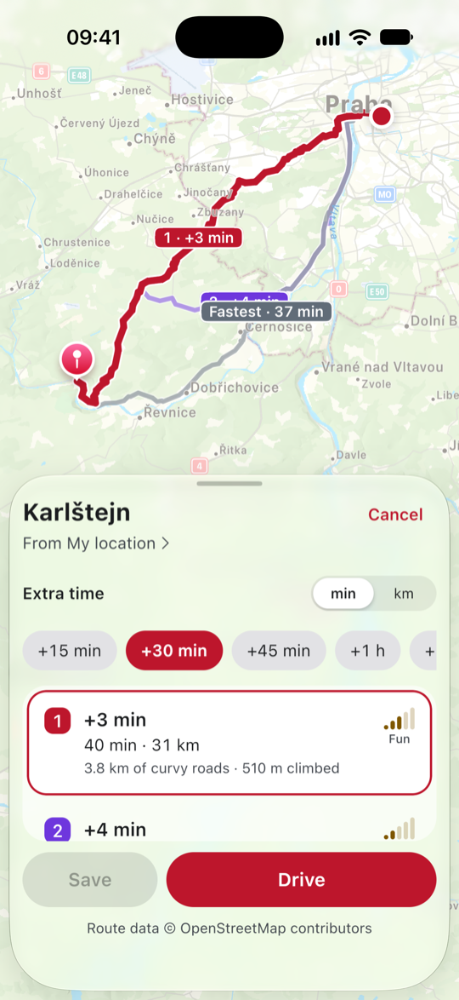
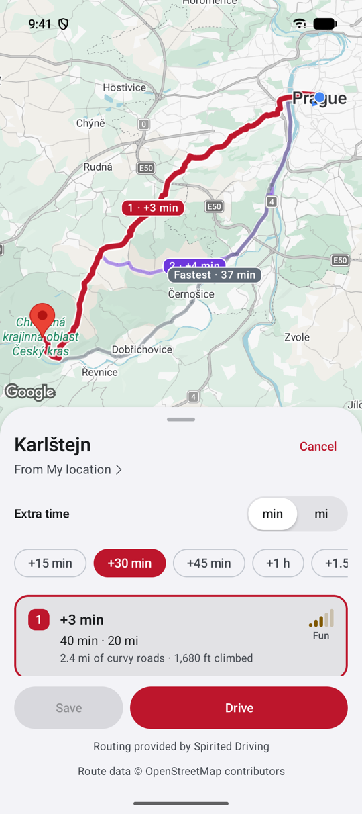
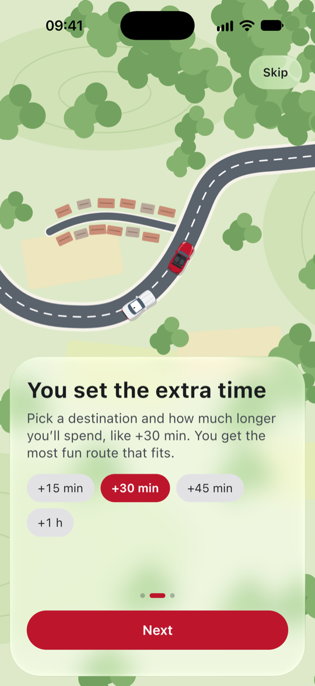
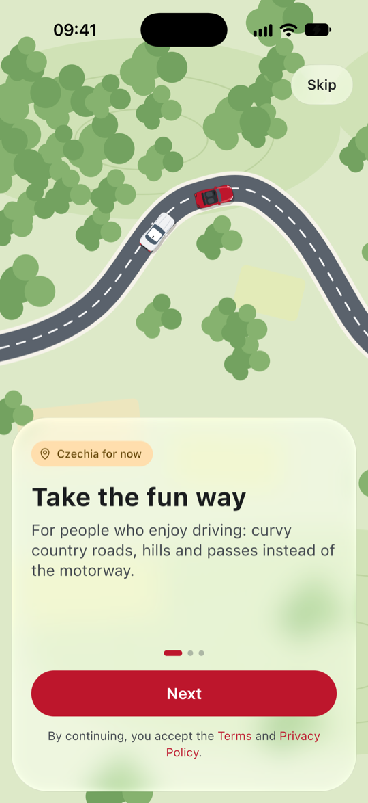
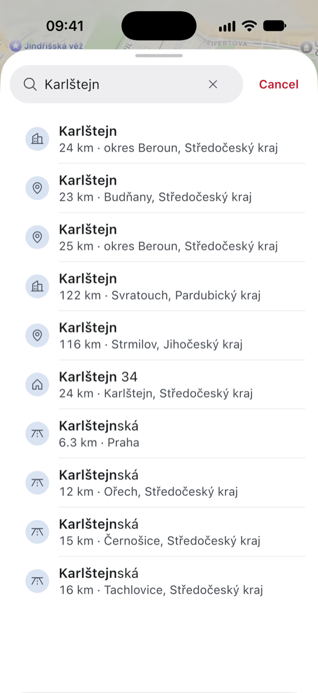
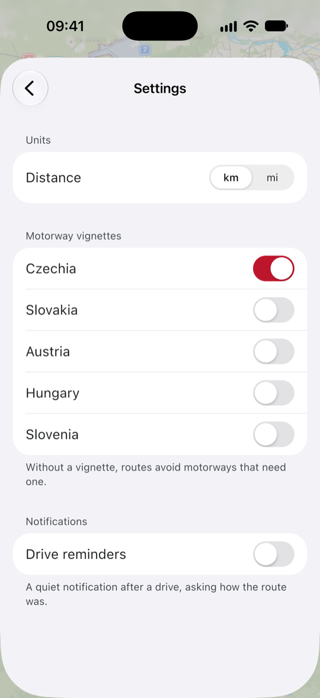

# Spirited Driving

A navigation app for people who enjoy driving. Pick a destination and say how much extra you're willing to spend on
the trip, like **+30 minutes**. The app finds the most enjoyable route that fits: curvy country roads, hills and
passes instead of the motorway.

<p align="center">
  
  &nbsp;
  
  &nbsp;
  
</p>

<p align="center"><sub>The same shared Compose screens on iOS (left) and Android (middle), around each platform's own map.</sub></p>


## What it does

Other driving apps ask "how curvy?" and show the cost afterwards. Spirited Driving asks "how much extra?" and finds
the most fun route within that limit, so it works for an everyday trip to the mall as well as for a weekend drive.
It's built for drivers of light, affordable sports cars, and for anyone who enjoys driving. It launches in Czechia.

| First launch | Search | Profile and settings |
|:---:|:---:|:---:|
|  |  |  |
| What the app does, the location permission and whether you have a motorway vignette | Places suggested as you type, with your recent places | Units, vignettes for nearby countries, drive reminders |

- **Map:** Google Maps on Android, Apple MapKit on iOS, centred on you, showing the area the app covers.
- **Route planning:** a budget in minutes or kilometres gives you the fastest route and fun routes within the
  budget. Each route shows its extra time, distance, kilometres of curvy road and metres climbed.
- **Drive:** the chosen route opens in Google Maps or Apple Maps with its waypoints, for turn-by-turn guidance.
- **Account:** sign in with Google, and delete the account from the app. Sign in with Apple is next.

The product design, features and what's next are in [docs/overview.md](docs/overview.md).

## What's in this repo

The Android and iOS app. Route planning and place search run on a backend, a separate project behind a versioned
HTTP API described by an OpenAPI specification. The app sends start, destination and budget, and gets back the
routes and the waypoints for the hand-off.

What the project shows:

- **One codebase, native feel.** Every screen's content is shared Compose Multiplatform. Navigation stays native on
  iOS (SwiftUI `NavigationStack`, native sheets and alerts), and the map is each platform's own SDK, with only the
  sheet content shared ([Architecture](docs/architecture.md#how-the-map-screen-is-built)).
- **Architecture the build enforces.** Features never see each other or the data layer, and the build fails when a
  module breaks that ([Modules](#modules)). [Konsist](https://docs.konsist.lemonappdev.com/) tests check the shape of
  components, view states, use cases, DTOs and APIs (`konsist/`).
- **Tested logic.** Use cases and DTO mapping have unit tests, run on CI with lint on every pull request.
- **Design written before code.** Each feature has a doc that says what it does and why, and a screen design while
  it's being built ([docs/features](docs/features)). The theme is in [docs/theme.md](docs/theme.md).
- **Platform services behind interfaces.** Location, Firebase sign-in, App Check and Crashlytics are interfaces in
  `:core:platform`, implemented with the native SDKs on each platform.
- **An AI-assisted workflow with guardrails.** The project is built with [Claude Code](https://claude.com/claude-code).
  Its skills (`.claude/skills`) and rules (`.claude/rules`) describe how to add a screen, an API call or a platform
  service here, and lint, Konsist and the module graph check what it writes.

## Tech stack

| Area           | Libraries                                                                                                   |
|----------------|-------------------------------------------------------------------------------------------------------------|
| Shared code    | Kotlin Multiplatform, Compose Multiplatform, coroutines, kotlinx.serialization, kotlinx-datetime            |
| Presentation   | [Decompose](https://arkivanov.github.io/Decompose/) with [Arkitekt](https://github.com/futuredapp/arkitekt), [Haze](https://github.com/chrisbanes/haze) for glass |
| DI             | Koin                                                                                                        |
| Network        | Ktor, Ktorfit, BuildKonfig flavors                                                                          |
| Storage        | DataStore                                                                                                   |
| Resources      | moko-resources, Phosphor icons                                                                              |
| Maps           | maps-compose (Google Maps) on Android, MapKit on iOS                                                        |
| Firebase       | Authentication, App Check, Crashlytics with [NSExceptionKt](https://github.com/rickclephas/NSExceptionKt) on iOS |
| iOS interop    | [SKIE](https://skie.touchlab.co/), a local Swift Package wrapping the KMP XCFramework                     |
| Quality        | ktlint, detekt, Android lint, Konsist, [modules-graph-assert](https://github.com/jraska/modules-graph-assert), baseline profiles |

## Modules

```
       androidApp          iosApp (Swift)
            └───────┬───────────┘
                 :shared          Koin graph, navigation hosts, logging, crash reporting, iOS framework
     ┌──────────────┼──────────────┐
 :feature:*    :data:network   :data:persistence
     └──────────────┼──────────────┘
 :core:domain   :core:ui   :core:resources   :core:platform
```

- **`:feature:*`** holds a feature's components, Compose screens and iOS view controllers: `:feature:onboarding`
  (first launch), `:feature:map` (the map, search and route planning) and `:feature:profile` (profile, settings and
  account). It depends on `:core:*` modules only, so features never see each other or the data implementations.
- **`:data:*`** holds the network client and local storage, and implements the interfaces in `:core:domain`. It
  depends on `:core:*` modules only.
- **`:core:*`** holds domain types and interfaces, the theme and Decompose base classes, shared strings and images,
  and the interfaces each platform implements natively.
- **`:shared`** is the only module that sees all others. Features meet each other in its navigation hosts, and
  domain interfaces meet their `:data:*` implementations in its Koin graph.

The build fails when a module breaks these rules, or when its longest dependency chain gets longer than four steps
(`moduleGraphAssert` in the root `build.gradle.kts`). A module's package and Android namespace come from its path
(`:data:network` is `com.syntey.spiriteddriving.data.network`), so a new feature's build file only applies
`conventions-kmp-feature`.

## UI architecture

Screens are implemented once in Compose Multiplatform, in the feature module that owns them, next to the component
they render (e.g. `feature/onboarding/.../ui/onboardingScreen/OnboardingScreenUi.kt`). A screen only draws its
content. Navigation chrome stays native:

- **Android:** navigation hosts in `androidApp/.../ui/navigation/*NavHostUi.kt` render Decompose stacks and slots,
  and draw top bars and bottom sheets around the shared screens.
- **iOS:** navigation stays in SwiftUI (`NavigationStack`, sheets), driven by Decompose. Each screen is exposed to
  Swift as a `*ScreenUiController` function (the feature's `src/iosMain/.../ui/ViewControllers.ios.kt`) and hosted
  by `ComposeView` in a thin SwiftUI view (`iosApp/SpiritedDriving/Views/Scenes/*/*Component.swift`), which also sets
  the native navigation title.

The map screen is the exception: it's built per platform around each platform's map SDK, with native glass buttons
and a native sheet on iOS, and only the sheet's content is shared Compose.

[Decompose](https://arkivanov.github.io/Decompose/) holds the navigation state in shared code:

```kotlin
Navigation("Root") {
    Slot {
        Screen("Onboarding") // First launch, until the vignette is answered
        Screen("TripPlan") // The map and its sheet, with Profile and its screens over it
    }
}
```

The full tree is in [docs/navigation.md](docs/navigation.md).

### Previews

Each screen has a preview-states object (e.g. `OnboardingPreviewStates`, in the feature's `model/ui`) with the view
states its previews share. Previews use the multipreview annotations in `:core:ui`: `@ScreenPreviews` renders a
screen in light and dark mode and with large fonts on dense phone screens, `@ComponentPreviews` a smaller composable
in light and dark mode with small and large fonts.

```kotlin
@ScreenPreviews
@Composable
private fun OnboardingScreenPreview() = Showcase {
    Content(viewState = OnboardingPreviewStates.viewState(), actions = noOpActions())
}
```

## Building it

1. Add a Maps SDK for Android key to `local.properties` as `MAPS_API_KEY=your-key`. Without it the Android map
   stays blank. The iOS map needs no key.
2. Android: `./gradlew :androidApp:assembleDebug`.
3. iOS: build the KMP framework once with
   `./gradlew assembleAndCopyDebugSwiftPackage -PkmpFrameworkTargets=simulator -PisStatic=false`, then open
   `iosApp/SpiritedDriving.xcodeproj` and run the `SpiritedDriving` scheme.
4. Checks: `./gradlew lintCheck testAndroidHostTest`, as CI runs them.

Dev builds expect the backend at `localhost:8080`, and Firebase features need your own Firebase config files.
Configuration, flavors and the iOS build setup are in [docs/development.md](docs/development.md).

## License

The source is published to be read. It may not be used, copied or redistributed; see [LICENSE](LICENSE).
