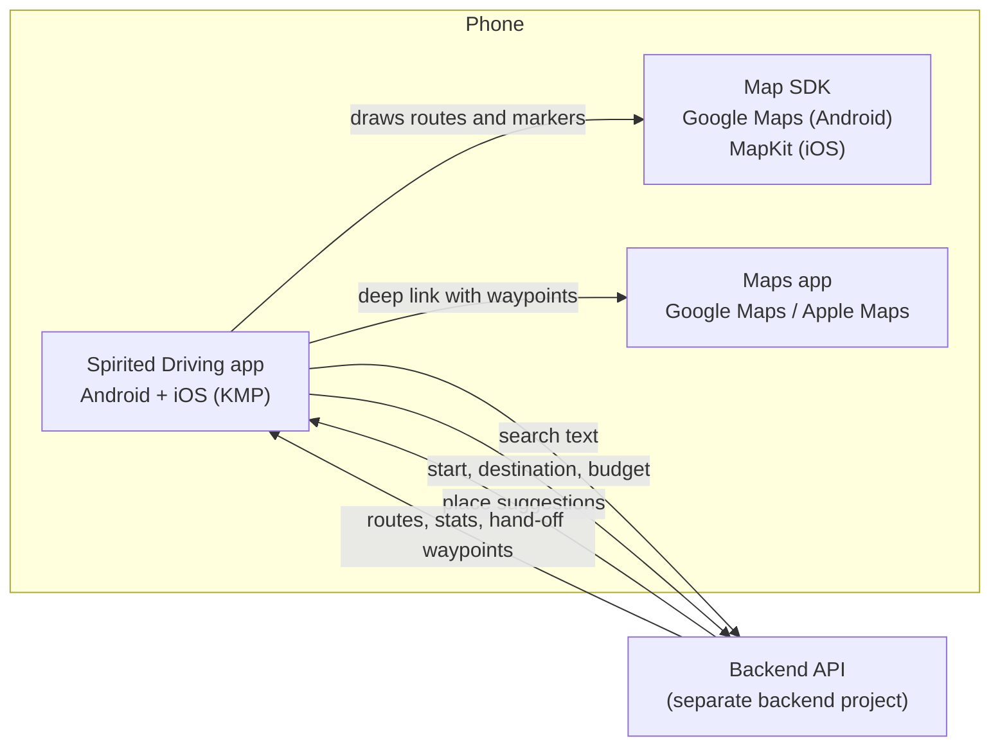

# Spirited Driving: Architecture

> **Status:** draft, being iterated. Last updated 2026-11-10.
>
> How the app is built. The product idea, core concepts and scope are in [overview.md](overview.md).

## Summary

- **Route planning, place search and user data live on a backend.** The backend is a separate project with its own
  specification. This repo holds the mobile app, which talks to the backend through an HTTP API.
- **The map is Google Maps on Android and Apple MapKit on iOS.** Both are free the way we use them.
- **Navigation in the MVP is a hand-off** to the platform's maps app (Google Maps on Android, Apple Maps on iOS) with
  waypoints.
- **Kotlin Multiplatform with shared Compose screens.** Logic and UI are shared: every screen's content is the same
  Compose code on both platforms. Platform code is the frame around it on iOS (navigation, sheets, alerts), the
  maps, and a few device services ([Shared and native UI](#shared-and-native-ui)).
- **One look on both platforms:** shared Compose UI, a light and a dark theme that follow the system, portrait
  only. Glass effects come from Haze and follow the platform: Liquid Glass style on iOS, frosted glass on Android
  (see [Theme](theme.md)).
- **Minimum OS: Android 12 (API 31) and iOS 26.** Native iOS parts, such as navigation bars and alerts, use the
  current design (Liquid Glass).

## System context



| Part        | Runs on    | Responsible for                                                          |
|-------------|------------|--------------------------------------------------------------------------|
| App         | Phone      | UI, map display, location, hand-off to the maps app                      |
| Backend API | Server     | Place search, route planning, user data                                  |
| Map SDK     | In the app | Base map, drawing route lines and markers                                |
| Maps app    | Phone      | Turn-by-turn guidance during the drive                                   |

## Route planning

The app sends start, destination and budget to the backend and gets back the baseline route and the fun routes.
The backend specification owns the API contract; the app keeps its own DTOs in `:data:network`.

**Plan a trip.** Input: start, destination, budget (+min or +km), the user's vignettes, and the most hand-off
waypoints the target maps app accepts. Output: the baseline route and 1–3 fun routes. Each route carries:

- an ID, used to save the route or record a drive on it
- geometry as an encoded polyline
- duration and distance
- stats for comparing routes (which ones is open, see [Route planning](features/route-planning/README.md))
- hand-off waypoints: a short, ordered list of points that keeps the maps app on this route (see
  [Navigation](#navigation))
- attribution for the route data ("© OpenStreetMap contributors")

In the app, route planning sits behind a `RoutePlanner` interface in `:core:domain`, with two implementations:

- `ApiRoutePlanner` in `:data:network` calls the backend.
- `FakeRoutePlanner` in `:core:domain` returns recorded plans for previews and tests, and lets the app run without
  a backend.

## Map

|       | Android                                                       | iOS                                    |
|-------|---------------------------------------------------------------|----------------------------------------|
| SDK   | Maps SDK for Android, through `maps-compose`                  | MapKit (`MKMapView`)                   |
| Cost  | $0, no usage limit while no map ID is used                    | $0 for native apps                     |
| Setup | Google Cloud project with billing enabled, restricted API key | Included in the Apple developer account |

To keep the Android map free:

- **No map ID.** A map ID moves map loads to the paid Dynamic Maps SKU. Style the map with JSON
  (`MapStyleOptions`) and use classic markers.
- **Only the map display is free.** Places, Geocoding, Routes and the Navigation SDK are billed separately.
- **A budget alert** on the Google Cloud project as a safety net.

Attribution: both SDKs show their own logo and legal notice. The app also shows "© OpenStreetMap contributors" for
the route data, and on Google maps in the EEA it shows "Routing provided by …" before navigation starts (Google Maps
Platform EEA terms).

### How the map screen is built

Screens are Compose Multiplatform, in the feature module that owns them. On iOS, native SwiftUI navigation hosts
each screen as a Compose view controller. The map screen is built per platform: the map, the sheet over it and the
map buttons are native on iOS, so the sheet and buttons are real Liquid Glass over the map. The sheet's content is
shared Compose on both platforms.

```
:feature:map   TripPlanComponent ──► RouteMapState (routes, markers, camera)
                                 └─► sheet state (search, budget, routes)

Android        :feature:map   MapScreenUi: GoogleMap + bottom sheet { TripPlanSheetUi }           maps-compose
iOS            iosApp         MapComponent: MKMapView + native sheet { ComposeView(TripPlanSheetUi) } SwiftUI, MapKit
```

- `RouteMapState` is an immutable model in common code: route lines (points, and whether a line is the baseline,
  a fun route or the selected one), start and destination markers, the covered area, camera bounds, and whether to
  show the user's location. Events go back up: map long-pressed (pick a destination), route tapped (select it), camera moved.
- Coordinates use a `GeoPoint` type from `:core:domain`, so no platform map type reaches shared code. Polyline
  decoding is in `:core:domain` too, with unit tests.
- The user's location reaches common code through `UserLocation` in `:core:platform` (the fused location provider on
  Android, `CLLocationManager` on iOS), only while the screen is started. Whether the map follows the user is
  `RouteMapState.followsUser`: on Android the map's camera moves with each location, on iOS it sets MapKit's own
  tracking mode, and MapKit leaving that mode when the user pans is reported back.
- `TripPlanSheetUi` is the sheet's content and its steps (search, route planning, one route), shared by both
  platforms: the search field, budget chips and route cards.
- **Android:** `MapScreenUi` (`:feature:map`, Android source set) draws the map with `maps-compose`, and the sheet
  and map buttons as solid Compose surfaces.
- **iOS:** `MapComponent` in Swift renders `RouteMapState` on an `MKMapView` with `MKPolyline` and annotations, and
  shows the map buttons with native glass. The sheet is a native sheet that stays open, with detents, and the map
  stays usable behind it. It hosts `TripPlanSheetUi` as a Compose view controller with a transparent background,
  so the native glass shows through. Screens opened from the map open as sheets stacked on it
  ([Navigation](navigation.md#screens-over-the-map)).
- Haze is used where Compose content is behind, such as a list scrolling under a header (see
  [Theme](theme.md#glass)). It doesn't sample native views, so it isn't used over the map.

## Navigation

The app opens the platform's maps app with the route's hand-off waypoints.

|                | Android                                                                                         | iOS                                                                          |
|----------------|-------------------------------------------------------------------------------------------------|------------------------------------------------------------------------------|
| Maps app       | Google Maps                                                                                     | Apple Maps                                                                   |
| Link           | `google.com/maps/dir/?api=1&destination=…&waypoints=a\|b&travelmode=driving&dir_action=navigate` | `maps.apple.com/directions?destination=…&waypoint=a&waypoint=b&mode=driving` |
| Waypoint limit | 9                                                                                               | Not documented; 9 until measured                                             |

- The maps app takes its own fastest path between waypoints, so the backend places them to keep it on the chosen
  roads. The app passes the target app's waypoint limit in the plan request.
- Building the link is common code in `:core:domain`, with unit tests. Opening it is a small platform call, the
  `PlatformMapsApp` binding: Android pins the link to Google Maps and iOS opens it as a universal link only, so a
  deleted or turned off maps app is reported instead of the link opening in a browser.
- Apple Maps links can't start navigation: Apple Maps opens with the directions, and the user taps Go.
- Each hand-off records a drive. The app makes the drive's ID and keeps the drive on the device (`StartedDrives` in
  `:data:persistence`), so one started offline is recorded on the next start of the map.
- Location permission is "while using" only: guidance runs in the maps app.
- The app isn't told when a drive ends. [Drive feedback](features/drive-feedback/README.md) works from the hand-off
  time and the route's planned duration, and a local notification scheduled at the hand-off, with no push server.

## Place search

Destination search comes from the backend on both platforms. The backend runs Photon, an open-source geocoder for
OpenStreetMap data that suggests places as you type.

- **Search places.** Input: the typed text, and the user's location (or the centre of the map without location
  access), which only orders places with the same name. Diacritics and case are ignored. Output: suggestions with name, area, coordinates, the kind of place (town, street,
  address, nature, place of interest) and whether it is in the covered area.
- **Reverse lookup.** Input: a point long-pressed on the map. Output: the nearest address, shown as the point's
  label.
- **Language:** calls carry the phone's preferred languages as `Accept-Language`. Place names come in that
  language where the map data has it, otherwise in the local one. The app's own strings stay English.

In the app, search sits behind a `PlaceSearch` interface in `:core:domain`, implemented by `ApiPlaceSearch` in
`:data:network` (and a fake for previews and tests):

- It searches from 2 characters, after a 300 ms pause in typing, and cancels a search still running when a new one
  starts.
- Recent places live in `:data:persistence`. Matching them against the typed text, and bolding the matched part of
  a name, ignore case and diacritics, in common code with unit tests.

## Accounts

Trip planning, place search, navigation and drive feedback work without an account. Most other features need the
user to sign in. Firebase Authentication handles sign-in. The backend keeps everything else about the user in its
own database, keyed by the Firebase user ID.

| Sign-in method      | Android | iOS |
|---------------------|---------|-----|
| Sign in with Google | Yes     | Yes |
| Sign in with Apple  | —       | Yes |

- Every Android user has a Google account, since the app comes from Google Play and the map needs Google Play
  services.
- A signed-out user has no Firebase user and no user ID. The same Google account reaches the same user on both
  platforms.
- Drives started while signed out are recorded without a user. The app keeps their IDs on the device, and after
  sign-in the backend attaches them to the account.
- The app opens straight into trip planning. Opening a feature that needs an account asks the user to sign in
  first.
- In the app, sign-in sits behind an interface in `:core:platform`, implemented with the native Firebase SDKs on
  each platform, like `PlatformFirebaseCrashlytics`.

Calls to the backend carry up to two tokens:

- **Firebase App Check token**, on every call: proves the call comes from the genuine app, through Play Integrity
  on Android and App Attest on iOS.
- **Firebase ID token**, while the user is signed in: identifies the user. The Firebase SDK keeps it fresh.

The backend verifies both and reads the user ID from the ID token. Features that need an account reject calls
without one.

## App structure

The modules and what each one holds for the MVP. A feature module is created with the first feature that goes
into it.

| Module                | Role                                                                  | Main parts                                             |
|-----------------------|-----------------------------------------------------------------------|--------------------------------------------------------|
| `:androidApp`         | Android entry point, draws the navigation hosts                       | Maps API key (see [Configuration](#configuration))     |
| `iosApp`              | SwiftUI shell: native navigation, hosts Compose screens               | `MapComponent` (MapKit map, native sheet, glass map buttons), Firebase sign-in |
| `:shared`             | Navigation hosts, Koin graph, logging, crash reporting, iOS framework | Wiring of `RoutePlanner` and `PlaceSearch` to their implementations |
| `:feature:map`        | [Map](features/map/README.md), [Destination search](features/destination-search/README.md), [Route planning](features/route-planning/README.md), [Drive](features/drive/README.md), [Drive feedback](features/drive-feedback/README.md) | `TripPlanComponent`, its use cases, `TripPlanSheetUi`, Android `MapScreenUi` |
| `:feature:routes`     | [Saved routes](features/saved-routes/README.md), [Trip history](features/trip-history/README.md) | `SavedRoutesComponent`, `TripHistoryComponent`, their use cases |
| `:feature:profile`    | Profile, [Settings](features/settings/README.md), [Account](features/account/README.md) |                     |
| `:feature:onboarding` | [First launch](features/first-launch/README.md)                       |                                                        |
| `:core:domain`        | Domain types, and the interfaces features reach data through          | `GeoPoint`, `Route`, `RoutePlanner`, `PlaceSearch`, domain errors, polyline decoding, the hand-off link |
| `:core:ui`            | Theme, shared components, Decompose base classes                      | Glass modifier, per-platform component styles          |
| `:core:resources`     | Shared strings and images                                             | Attribution texts                                      |
| `:core:platform`      | Interfaces implemented natively on each platform                      | Location, Firebase sign-in and App Check, local notifications, the in-app browser |
| `:data:network`       | Ktorfit/Ktor client, DTOs, `NetworkResult`                            | `ApiRoutePlanner`, `ApiPlaceSearch`, `ApiCoverageSource` |
| `:data:persistence`   | DataStore                                                             | The covered area, recent places, settings, last used budget, IDs of drives started while signed out, the drive waiting for a rating, ratings not sent yet |

Features that share state share a module: one `TripPlanComponent` drives the map and its sheet, so everything shown
on the map is `:feature:map`.

`:feature:*` and `:data:*` modules depend on `:core:*` modules only, and the build fails otherwise (see "Modules" in
the [README](../README.md#modules)). So features don't see each other, and reach data only through the
`:core:domain` interfaces. They meet in `:shared`:

- Its navigation hosts create each feature's screens through a public `*Screens` object in the feature, and connect
  them, for example Profile opening Trip history.
- Its Koin graph binds the `:core:domain` interfaces to their `:data:*` implementations.

Inside a feature, the component holds immutable view state, handles events and drives navigation; use cases hold
the logic, and are cancelled with the component. Work that has to finish after its screen closes, such as a saved
route's delete when the list closes during its Undo, runs in `AppWork`, which lasts as long as the app. `RoutePlanner`
and `PlaceSearch` hide where data comes from. Network errors (`NetworkError`) map to
domain errors the UI can explain: offline, no route within the budget, region not covered.

How features map to screens is in [navigation.md](navigation.md).

### Shared and native UI

The content of every screen is shared Compose in its feature module, one implementation for both platforms.
Platform code draws only the frame around it:

| Part                                                   | Android                                        | iOS                                 |
|--------------------------------------------------------|------------------------------------------------|-------------------------------------|
| Screen and sheet content: lists, cards, buttons, chips | Compose, shared                                | Compose, shared                     |
| Navigation between screens                             | Compose                                        | SwiftUI                             |
| Navigation bars                                        | Compose, `AndroidTopBar` in each shared screen | SwiftUI                             |
| Sheets                                                 | Compose                                        | SwiftUI, hosting the shared content |
| Alerts                                                 | Compose (Material dialog)                      | Native alert                        |
| Map and map buttons                                    | Compose (`maps-compose`)                       | SwiftUI, MapKit                     |
| Web pages (legal pages, licences)                      | Custom Tab                                     | Safari view controller              |

The Platforms tables in the [screen designs](overview.md#design) (sizes, button and chip styles, iOS-style or
Material lists) are values of the same shared components. Both platforms' values sit side by side in `PlatformStyle`
in `:core:ui`, and `AppTheme` picks the set of the platform the app runs on, so a preview can show either. A component
only one feature uses, like the map's search field, lives in that feature with its values in the feature's own style
(`MapPlatformStyle`), picked by `AppTheme.platform` the same way. Only a
component that needs a platform library is split into `.android.kt` / `.ios.kt`, like the glass
([Theme](theme.md#materials)). No screen is written twice.

## Configuration

- **Google Maps API key:** kept out of git. It comes from `MAPS_API_KEY` in `local.properties` locally and from the
  `MAPS_API_KEY` environment variable (a CI secret) for release builds, and is restricted in the Cloud console to the
  app's package name and signing certificate. Without it the Android map stays blank.
- **Backend base URL:** per build flavor (dev, prod) through BuildKonfig. Dev builds call the local backend; on an
  Android phone it's at the address in `ANDROID_DEV_API_URL` in `local.properties`.

## Test cases

To check on real devices once the parts exist:

1. **iOS map sheet:** the Compose content in the native sheet feels native: moving between detents, scrolling
   inside the sheet, the keyboard while searching, and the glass showing through the transparent background.
2. **Hand-off fidelity:** Google Maps and Apple Maps follow the planned route when given its waypoints. Test on
   trips the author knows well.

## Sources

- [Maps SDK for Android usage and billing](https://developers.google.com/maps/documentation/android-sdk/usage-and-billing)
- [Google Maps Platform pricing](https://developers.google.com/maps/billing-and-pricing/pricing)
- [Google Maps URLs](https://developers.google.com/maps/documentation/urls/get-started)
- [Google Maps Platform EEA Service Specific Terms](https://cloud.google.com/terms/maps-platform/eea/maps-service-terms)
- [Apple: Adopting unified Maps URLs](https://developer.apple.com/documentation/mapkit/unified-map-urls)
- [Apple Developer Forums: cost of MapKit in native apps](https://developer.apple.com/forums/thread/744000)
- [Photon geocoder](https://github.com/komoot/photon)
- [Haze](https://chrisbanes.github.io/haze/),
  [Haze: UIKit interop](https://chrisbanes.github.io/haze/dev/scenarios/uikit-interop/)
- [Firebase Authentication](https://firebase.google.com/docs/auth),
  [Firebase App Check](https://firebase.google.com/docs/app-check)
