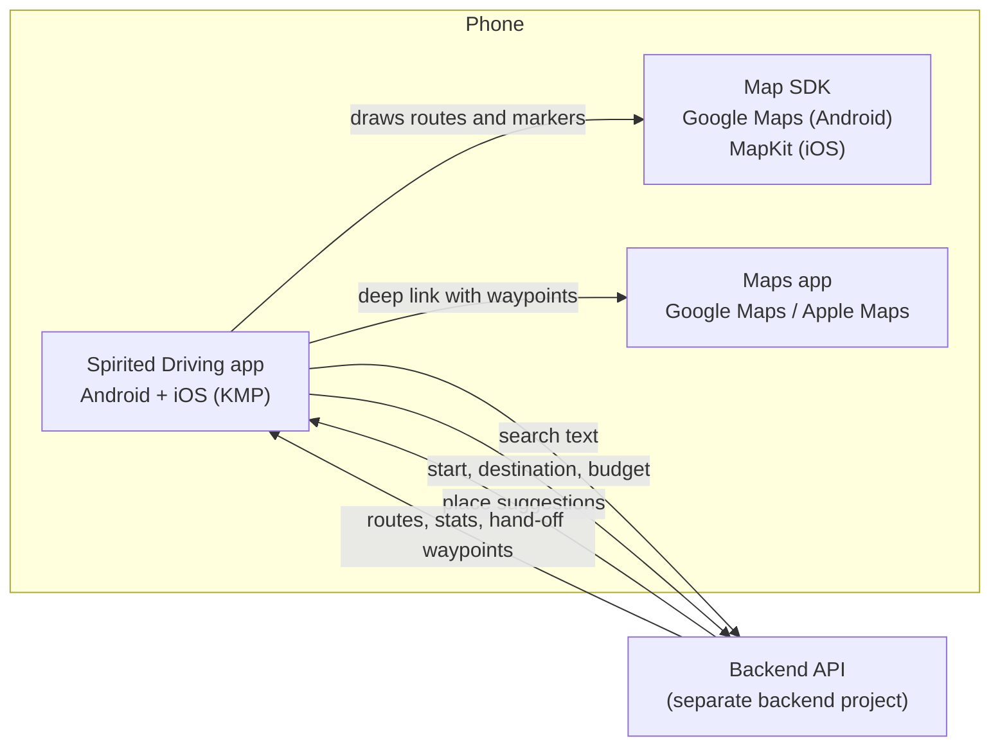

# Spirited Driving: Architecture

> **Status:** draft, being iterated. Last updated 2026-11-06.
>
> How the app is built. The product idea, core concepts and scope are in [overview.md](overview.md).

## Summary

- **Route planning, place search and user data live on a backend.** The backend is a separate project with its own
  specification. This repo holds the mobile app, which talks to the backend through an HTTP API.
- **The map is Google Maps on Android and Apple MapKit on iOS.** Both are free the way we use them.
- **Navigation in the MVP is a hand-off** to the platform's maps app (Google Maps on Android, Apple Maps on iOS) with
  waypoints.
- **Kotlin Multiplatform with shared Compose screens.** Logic and UI are shared. The map view and a few device
  services are platform code behind shared interfaces.
- **One look on both platforms:** shared Compose UI with glass effects from Haze, a light and a dark theme that
  follow the system, portrait only.
- **Minimum OS: Android 12 (API 31) and iOS 26.** Native iOS parts, such as navigation bars and alerts, use the
  current design (Liquid Glass).

## System context



| Part        | Runs on    | Responsible for                                                          |
|-------------|------------|--------------------------------------------------------------------------|
| App         | Phone      | UI, map display, location, hand-off to the maps app                      |
| Backend API | Server     | Place search, route planning, user data                                  |
| Map SDK     | In the app | Base map, drawing route lines and markers                                |
| Maps app    | Phone      | Turn-by-turn guidance during the drive                                   |

## Route planning

The app sends start, destination and budget to the backend and gets back the baseline route and the fun routes.
The backend specification owns the API contract; the app keeps its own DTOs in `shared:network:rest`.

**Plan a trip.** Input: start, destination, budget (+min or +km), the user's vignettes, and the most hand-off
waypoints the target maps app accepts. Output: the baseline route and 1–3 fun routes. Each route carries:

- an ID, used to save the route or record a drive on it
- geometry as an encoded polyline
- duration and distance
- stats for comparing routes (which ones is open, see [Route planning](features/route-planning.md))
- hand-off waypoints: a short, ordered list of points that keeps the maps app on this route (see
  [Navigation](#navigation))
- attribution for the route data ("© OpenStreetMap contributors")

In the app, route planning sits behind a `RoutePlanner` interface in shared domain code, with two implementations:

- `ApiRoutePlanner` calls the backend through `shared:network:rest`.
- `FakeRoutePlanner` returns recorded plans for previews and tests, and lets the app run without a backend.

## Map

|       | Android                                                       | iOS                                    |
|-------|---------------------------------------------------------------|----------------------------------------|
| SDK   | Maps SDK for Android, through `maps-compose`                  | MapKit (`MKMapView`)                   |
| Cost  | $0, no usage limit while no map ID is used                    | $0 for native apps                     |
| Setup | Google Cloud project with billing enabled, restricted API key | Included in the Apple developer account |

To keep the Android map free:

- **No map ID.** A map ID moves map loads to the paid Dynamic Maps SKU. Style the map with JSON
  (`MapStyleOptions`) and use classic markers.
- **Only the map display is free.** Places, Geocoding, Routes and the Navigation SDK are billed separately.
- **A budget alert** on the Google Cloud project as a safety net.

Attribution: both SDKs show their own logo and legal notice. The app also shows "© OpenStreetMap contributors" for
the route data, and on Google maps in the EEA it shows "Routing provided by …" before navigation starts (Google Maps
Platform EEA terms).

### How the map fits into shared UI

Screens are Compose Multiplatform (`shared:ui`). On iOS, native SwiftUI navigation hosts each screen as a Compose
view controller. The map is the one part of a screen that is native on each platform:

```
shared:feature   TripPlanComponent ──► RouteMapState (routes, markers, camera)
                                            │
shared:ui        TripPlanScreenUi ──► RouteMap(state, onEvent)          expect
                                            │
                   androidMain   GoogleMap { Polyline, Marker }         maps-compose
                   iosMain       UIKitViewController(MapViewFactory)    Swift, MKMapView
```

- `RouteMapState` is an immutable model in common code: route lines (points, and whether a line is the baseline,
  a fun route or the selected one), start and destination markers, camera bounds, and whether to show the user's
  location. Events go back up: map long-pressed (pick a destination), route tapped (select it), camera moved.
- Coordinates use a common `GeoPoint` type, so no platform map type reaches shared code. Polyline decoding is
  common code with unit tests.
- **Android:** the `RouteMap` actual uses `maps-compose`.
- **iOS:** the `RouteMap` actual embeds a `UIViewController` that Swift creates through a `MapViewFactory`, a Kotlin
  interface implemented in Swift and registered at startup like `PlatformBindings`. Swift renders the state with
  `MKPolyline` and annotations.
- Search bar, budget chips and route cards are shared Compose UI on top of the map. Haze blurs only what Compose
  draws, and the map is native, so surfaces over the map are translucent and tinted, without blur. Haze blur is
  used where Compose content is behind, such as a list scrolling under a header.

## Navigation

The app opens the platform's maps app with the route's hand-off waypoints.

|                | Android                                                                                         | iOS                                                                          |
|----------------|-------------------------------------------------------------------------------------------------|------------------------------------------------------------------------------|
| Maps app       | Google Maps                                                                                     | Apple Maps                                                                   |
| Link           | `google.com/maps/dir/?api=1&destination=…&waypoints=a\|b&travelmode=driving&dir_action=navigate` | `maps.apple.com/directions?destination=…&waypoint=a&waypoint=b&mode=driving` |
| Waypoint limit | 9                                                                                               | Not documented; to measure                                                   |

- The maps app takes its own fastest path between waypoints, so the backend places them to keep it on the chosen
  roads. The app passes the target app's waypoint limit in the plan request.
- Building the link is common code with unit tests. Opening it is a small platform call.
- Location permission is "while using" only: guidance runs in the maps app.

## Place search

Destination search comes from the backend on both platforms. The backend runs Photon, an open-source geocoder for
OpenStreetMap data that suggests places as you type.

- **Search places.** Input: the typed text and the user's location, so nearby places rank first. Output:
  suggestions with name, address and coordinates.
- **Reverse lookup.** Input: a point tapped on the map. Output: the nearest address, shown as the destination's
  label.

In the app, search sits behind a `PlaceSearch` interface in shared code, implemented by `ApiPlaceSearch` (and a fake
for previews and tests). The app waits for a short pause in typing before it calls the API.

## Accounts

Trip planning, place search, navigation and drive feedback work without an account. Most other features need the
user to sign in. Firebase Authentication handles sign-in. The backend keeps everything else about the user in its
own database, keyed by the Firebase user ID.

| Sign-in method      | Android | iOS |
|---------------------|---------|-----|
| Sign in with Google | Yes     | Yes |
| Sign in with Apple  | —       | Yes |

- Every Android user has a Google account, since the app comes from Google Play and the map needs Google Play
  services.
- A signed-out user has no Firebase user and no user ID. The same Google account reaches the same user on both
  platforms.
- Drives started while signed out are recorded without a user. The app keeps their IDs on the device, and after
  sign-in the backend attaches them to the account.
- The app opens straight into trip planning. Opening a feature that needs an account asks the user to sign in
  first. (The template's root navigation starts at the login screen; that changes.)
- In the app, sign-in sits behind an interface in `shared:platform`, implemented with the native Firebase SDKs on
  each platform, like `PlatformFirebaseCrashlytics`.

Calls to the backend carry up to two tokens:

- **Firebase App Check token**, on every call: proves the call comes from the genuine app, through Play Integrity
  on Android and App Attest on iOS.
- **Firebase ID token**, while the user is signed in: identifies the user. The Firebase SDK keeps it fresh.

The backend verifies both and reads the user ID from the ID token. Features that need an account reject calls
without one.

## App structure

The existing modules and what each one gets for trip planning:

| Module                | Role                                                    | Trip planning parts                                    |
|-----------------------|---------------------------------------------------------|--------------------------------------------------------|
| `androidApp`          | Android entry point                                     | Maps API key (see [Configuration](#configuration))     |
| `iosApp`              | SwiftUI shell: native navigation, hosts Compose screens | MapKit map view, `MapViewFactory`, Firebase sign-in    |
| `shared:app`          | DI graph, logging, crash reporting                      | Wiring of the new interfaces                           |
| `shared:feature`      | Decompose components, use cases, navigation             | `TripPlanComponent`, use cases, `RoutePlanner`, `PlaceSearch` |
| `shared:ui`           | Compose Multiplatform screens                           | Trip planning screen, `RouteMap` (expect/actual)       |
| `shared:network:rest` | Ktorfit/Ktor client, DTOs, `NetworkResult`              | Backend API client                                     |
| `shared:persistence`  | DataStore                                               | Recent destinations, settings, last used budget, IDs of drives started while signed out |
| `shared:platform`     | Interfaces implemented natively on each platform        | Location, Firebase sign-in and App Check               |
| `shared:resources`    | Shared strings and images                               | Attribution texts                                      |

`shared:network:graphql` comes from the project template (sample API) and will be removed.

Inside a feature, the component holds immutable view state, handles events and drives navigation; use cases hold
the logic; `RoutePlanner` and `PlaceSearch` hide where data comes from. Network errors (`NetworkError`) map to
domain errors the UI can explain: offline, no route within the budget, region not covered.

Each [feature](overview.md#features) gets its own components and use cases. How features map to screens is in
[navigation.md](navigation.md).

## Configuration

- **Google Maps API key:** kept out of git. It comes from `local.properties` locally and from a CI secret for
  release builds, and is restricted in the Cloud console to the app's package name and signing certificate.
- **Backend base URL:** per build flavor (dev, prod) through BuildKonfig.

## Test cases

To check on real devices once the parts exist:

1. **iOS map screen:** Compose UI over the MapKit view feels native, including panning, zooming and tapping
   routes.
2. **Hand-off fidelity:** Google Maps and Apple Maps follow the planned route when given its waypoints. Test on
   trips the author knows well.

## Sources

- [Maps SDK for Android usage and billing](https://developers.google.com/maps/documentation/android-sdk/usage-and-billing)
- [Google Maps Platform pricing](https://developers.google.com/maps/billing-and-pricing/pricing)
- [Google Maps URLs](https://developers.google.com/maps/documentation/urls/get-started)
- [Google Maps Platform EEA Service Specific Terms](https://cloud.google.com/terms/maps-platform/eea/maps-service-terms)
- [Apple: Adopting unified Maps URLs](https://developer.apple.com/documentation/mapkit/unified-map-urls)
- [Apple Developer Forums: cost of MapKit in native apps](https://developer.apple.com/forums/thread/744000)
- [Photon geocoder](https://github.com/komoot/photon)
- [Haze](https://chrisbanes.github.io/haze/),
  [Haze: UIKit interop](https://chrisbanes.github.io/haze/dev/scenarios/uikit-interop/)
- [Firebase Authentication](https://firebase.google.com/docs/auth),
  [Firebase App Check](https://firebase.google.com/docs/app-check)
